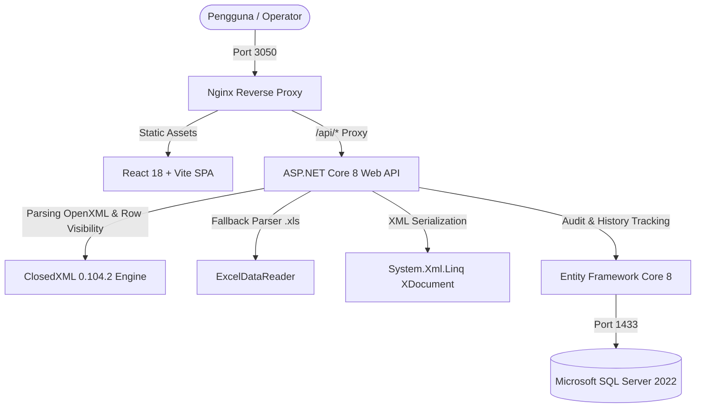

# Panduan Pengembangan (Development Guide)
## Aplikasi Konversi Excel ke XML (SKK Migas - SOT Production & SOT L-PUMA)
### Lingkungan: JOB PERTAMINA - MEDCO E&P SIMENGGARIS

Dokumen ini ditujukan sebagai panduan komprehensif bagi developer atau perekayasa perangkat lunak untuk memahami arsitektur, menjalankan aplikasi di lingkungan lokal, melakukan pengembangan fitur lanjutan, menguji kode, hingga melakukan deployment ke server produksi.

---

## Daftar Isi
1. [Ringkasan & Domain Bisnis](#1-ringkasan--domain-bisnis)
2. [Arsitektur Sistem & Tech Stack](#2-arsitektur-sistem--tech-stack)
3. [Prasyarat Sistem (Prerequisites)](#3-prasyarat-sistem-prerequisites)
4. [Cara Menjalankan Aplikasi (Quick Start)](#4-cara-menjalankan-aplikasi-quick-start)
   - [Opsi A: Menggunakan Docker Compose (Direkomendasikan)](#opsi-a-menggunakan-docker-compose-direkomendasikan)
   - [Opsi B: Local Development (Bare-Metal / Hybrid)](#opsi-b-local-development-bare-metal--hybrid)
5. [Struktur Direktori Proyek](#5-struktur-direktori-proyek)
6. [Bedah Kode & Komponen Utama](#6-bedah-kode--komponen-utama)
   - [Backend (.NET 8 Web API)](#backend-net-8-web-api)
   - [Frontend (React 18 + Vite + TypeScript)](#frontend-react-18--vite--typescript)
7. [Mekanisme Fitur Inti (Core Logic)](#7-mekanisme-fitur-inti-core-logic)
   - [Dukungan Excel Filter & Grouping (Row Visibility)](#dukungan-excel-filter--grouping-row-visibility)
   - [Hierarki Serialisasi XML ProdML & LPO](#hierarki-serialisasi-xml-prodml--lpo)
   - [Validasi Skema & Enum LPO](#validasi-skema--enum-lpo)
   - [Manajemen Basis Data & Multi-Provider (SQL Server & SQLite)](#manajemen-basis-data--multi-provider-sql-server--sqlite)
8. [Panduan Pengembangan Fitur Lanjutan (How-To)](#8-panduan-pengembangan-fitur-lanjutan-how-to)
   - [Menambah / Mengubah Kolom Pemetaan Excel](#a-menambah--mengubah-kolom-pemetaan-excel)
   - [Menambah Skema Konversi Baru (Contoh: Skema 3)](#b-menambah-skema-konversi-baru-contoh-skema-3)
   - [Mengubah Schema Database & Migrasi EF Core](#c-mengubah-schema-database--migrasi-ef-core)
   - [Menambahkan Aturan Validasi Bisnis Baru](#d-menambahkan-aturan-validasi-bisnis-baru)
9. [Pengujian (Testing & QA)](#9-pengujian-testing--qa)
   - [Automated End-to-End Test (Python)](#automated-end-to-end-test-python)
   - [Daftar Periksa Pengujian Manual (Manual Checklist)](#daftar-periksa-pengujian-manual-manual-checklist)
10. [Panduan Deployment & Operasional Server](#10-panduan-deployment--operasional-server)
11. [Troubleshooting & FAQ](#11-troubleshooting--faq)

---

## 1. Ringkasan & Domain Bisnis

Aplikasi ini dikembangkan untuk mengotomatisasi transformasi data pelaporan operasional harian industri hulu migas dari berkas spreadsheet Excel (`.xlsx` / `.xls`) menjadi berkas XML berstandar resmi SKK Migas:

1. **SOT Production (ProdML v1.2.2)**:
   - Standar transfer data volume produksi migas harian.
   - Mencakup data fasilitas, jenis alur fluida (*flow*), produk (minyak, gas, air kondensat), periode volume, dan neraca kargo (*balanceSet / cargo lifting*).
   - Memetakan **31 kolom** standar.

2. **SOT L-PUMA (Loss Production Opportunity / LPO v1.2)**:
   - Standar pelaporan kehilangan kesempatan produksi akibat sumur mati (*well off*), kegiatan perawatan (*planned shutdown*), atau gangguan peralatan tak terduga (*unplanned event*).
   - Mencakup event downtime, waktu mulai & selesai (ISO-8601), penyebab level 1-2, kategori, dan estimasi kehilangan volume minyak (BBLS) & gas (MMSCF).
   - Memetakan **22 kolom** standar dengan validasi enumerasi ketat (*XSD validation rules*).

3. **Fitur Kritis Lapangan (Row Visibility)**:
   - File Excel dari operator lapangan sering menggunakan **AutoFilter** atau **Outline Grouping** (tanda `[-]` di-collapse).
   - Sistem membaca metadata keterlihatan baris (*row visibility*) sehingga **hanya baris yang aktif / terlihat di Excel yang diekspor ke XML**, sedangkan baris tersembunyi dilewati secara transparan.

---

## 2. Arsitektur Sistem & Tech Stack



### Rincian Teknologi:
- **Backend**:
  - Bahasa: C# (.NET 8 SDK / ASP.NET Core Web API)
  - ORM: Entity Framework Core 8 (`Microsoft.EntityFrameworkCore.SqlServer` & `Microsoft.EntityFrameworkCore.Sqlite`)
  - Parser Spreadsheet: `ClosedXML` v0.104.2 (utama untuk `.xlsx` dengan pembacaan atribut `IsHidden`) dan `ExcelDataReader` v3.7.0 (fallback untuk `.xls` legasi).
  - Serialisasi Dokumen: `System.Xml.Linq` (`XDocument`, `XElement`, `XAttribute`, `XNamespace`).
  - Dokumentasi API: Swagger / OpenAPI (`Swashbuckle.AspNetCore`).
- **Frontend**:
  - Framework: React 18 (TypeScript)
  - Build Tool: Vite 6
  - Ikon: `lucide-react`
  - Styling: Vanilla CSS modern korporat (tanpa ketergantungan library CSS pihak ketiga yang bloated; mendukung responsif, dark/light contrast tinggi, animasi transisi lembut, notifikasi status).
- **Infrastruktur & Containerization**:
  - Web Server Frontend: Nginx Alpine (melayani SPA + reverse proxy `/api/` ke container backend).
  - Database Container: `mcr.microsoft.com/mssql/server:2022-latest` (Linux/amd64).
  - Orchestration: Docker Compose v2.

---

## 3. Prasyarat Sistem (Prerequisites)

Sebelum memulai pengembangan, pastikan perangkat lokal Anda telah terpasang:
- **Docker Desktop** (atau Docker Engine v24+ & Docker Compose v2+)
- **Git**
- *(Opsional untuk mode Local Bare-Metal)*:
  - **.NET 8 SDK** (`dotnet --version` output >= `8.0.x`)
  - **Node.js** v20+ atau v22+ (`node -v`) & **npm** v10+ (`npm -v`)
  - **Python 3.9+** (untuk menjalankan skrip `test_e2e.py`)
  - Database Client: **Azure Data Studio**, **DBeaver**, atau **VS Code Database Client extension**.

---

## 4. Cara Menjalankan Aplikasi (Quick Start)

### Opsi A: Menggunakan Docker Compose (Direkomendasikan)
Metode ini adalah cara paling cepat untuk menyalakan seluruh stack aplikasi (Database SQL Server, Backend API, dan Frontend React) dalam lingkungan yang identik dengan server produksi.

1. **Clone repositori**:
   ```bash
   git clone <repository-url>
   cd sitemenggaris
   ```

2. **Inisialisasi file konfigurasi environment**:
   ```bash
   cp .env.example .env
   ```
   *Catatan Port Default:*
   - `FRONTEND_PORT=3050` (dipilih 3050 agar tidak bentrok dengan service lain seperti m2prime di port 3000)
   - `BACKEND_PORT=5050`
   - `SQLSERVER_PORT=1433`
   - `MSSQL_SA_PASSWORD=Simenggaris2026!`
   - `DB_NAME=SitemenggarisDb`

3. **Build dan jalankan seluruh container**:
   ```bash
   docker compose up -d --build
   ```

4. **Verifikasi status container**:
   ```bash
   docker compose ps
   ```
   Pastikan ketiga container berstatus `Up` / `Healthy`:
   - `excel-to-xml-sqlserver`
   - `excel-to-xml-backend`
   - `excel-to-xml-frontend`

5. **Akses aplikasi**:
   - Web Frontend: [http://localhost:3050](http://localhost:3050)
   - Backend Swagger UI: [http://localhost:5050/swagger](http://localhost:5050/swagger)
   - SQL Server: `localhost:1433` (User: `sa`, Password: `Simenggaris2026!`)

6. **Menghentikan aplikasi**:
   ```bash
   docker compose down
   # Jika ingin menghapus volume database sekaligus:
   # docker compose down -v
   ```

---

### Opsi B: Local Development (Bare-Metal / Hybrid)
Metode ini sangat disarankan saat Anda aktif mengubah kode C# atau React dengan kebutuhan *hot-reload* cepat tanpa perlu mem-build image Docker berulang kali.

#### 1. Jalankan Database SQL Server via Docker
Anda tidak perlu menginstall SQL Server di OS lokal, cukup jalankan container SQL Server:
```bash
docker compose up -d sqlserver
```
*(Alternatif: Backend juga mendukung SQLite otomatis jika string koneksi diubah ke `Data Source=data/app.db`).*

#### 2. Menjalankan Backend (.NET 8 Web API)
Buka terminal baru:
```bash
cd backend/ExcelToXmlApi

# Restore dependensi NuGet
dotnet restore

# Jalankan backend API
dotnet run
```
Backend akan aktif di `http://localhost:5000` (atau `http://localhost:5050` sesuai profil peluncuran). Swagger dapat diakses di:
[http://localhost:5000/swagger](http://localhost:5000/swagger)

#### 3. Menjalankan Frontend (Vite Dev Server)
Buka terminal baru:
```bash
cd frontend

# Install package npm
npm install

# Jalankan server Vite development
npm run dev
```
Vite akan membuka dev server di [http://localhost:3000](http://localhost:3000). 
Konfigurasi `frontend/vite.config.ts` sudah dilengkapi proxy otomatis: setiap pemanggilan ke `/api/*` pada browser akan diteruskan ke backend `http://localhost:5000`.

---

## 5. Struktur Direktori Proyek

```
sitemenggaris/
├── .env.example                     # Contoh konfigurasi variabel lingkungan produksi
├── .gitignore                       # Berkas yang dikecualikan dari Git (termasuk docs/ & bin/obj/)
├── README.md                        # Dokumentasi ringkas proyek
├── deploy.sh                        # Skrip otomatisasi deployment server Linux
├── docker-compose.yml               # Definisi multi-container (sqlserver, backend, frontend)
├── test_e2e.py                      # Skrip automated end-to-end testing
│
├── backend/
│   └── ExcelToXmlApi/
│       ├── Controllers/
│       │   └── ConverterController.cs       # Endpoint REST API (convert, history, download, template)
│       ├── Data/
│       │   └── AppDbContext.cs              # EF Core context (SQL Server / SQLite hybrid)
│       ├── DTOs/
│       │   └── ConversionDtos.cs            # Data Transfer Objects untuk request & response
│       ├── Models/
│       │   ├── ConversionRecord.cs          # Entitas histori konversi untuk tabel database
│       │   ├── SotLpumaRow.cs               # POCO representasi 22 kolom baris LPO
│       │   └── SotProductionRow.cs          # POCO representasi 31 kolom baris ProdML
│       ├── Services/
│       │   ├── ISotLpumaConverter.cs        # Kontrak converter L-PUMA
│       │   ├── ISotProductionConverter.cs   # Kontrak converter SOT Production
│       │   ├── LpoEnumValidator.cs          # Kamus & validasi enumerasi standar XSD LPO
│       │   ├── SotLpumaConverter.cs         # Implementasi ClosedXML parser & XML generator L-PUMA
│       │   ├── SotProductionConverter.cs    # Implementasi ClosedXML parser & XML generator ProdML
│       │   └── TemplateGeneratorService.cs  # Pembangkit berkas template Excel resmi (.xlsx)
│       ├── Dockerfile                       # Multi-stage build .NET 8 SDK -> ASP.NET runtime
│       ├── Program.cs                       # Entry point, DI container, retry loop SQL Server, CORS
│       ├── appsettings.json                 # Konfigurasi default & ConnectionStrings
│       └── ExcelToXmlApi.csproj             # Daftar NuGet packages & target runtime
│
├── frontend/
│   ├── src/
│   │   ├── components/
│   │   │   ├── ConversionForm.tsx           # Form upload, dropzone, schema selector, & notes
│   │   │   ├── ConversionHistory.tsx        # Tabel riwayat konversi, filter tanggal, & pagination
│   │   │   ├── Header.tsx                   # Navbar branding Pertamina - Medco Simenggaris
│   │   │   ├── HelpSection.tsx              # Panduan pengguna, download template, & tabel mapping
│   │   │   ├── HistoryDetailModal.tsx       # Modal detail riwayat konversi & download ulang
│   │   │   ├── Sidebar.tsx                  # Menu navigasi samping SPA
│   │   │   └── XmlPreviewModal.tsx          # Modal syntax viewer XML dengan tombol copy & download
│   │   ├── types/
│   │   │   └── index.ts                     # Definisi tipe TypeScript (ConversionResponse, SchemaType, dll)
│   │   ├── App.tsx                          # Root component & tab state management
│   │   ├── index.css                        # Design system & stylesheet utama
│   │   └── main.tsx                         # Entry point React DOM
│   ├── nginx.conf                           # Konfigurasi Nginx proxy & client-side routing
│   ├── Dockerfile                           # Multi-stage build Node 22 -> Nginx Alpine
│   ├── package.json                         # Dependensi NPM React, TypeScript, Vite
│   └── vite.config.ts                       # Konfigurasi build Vite & dev proxy
│
└── docs/                                    # Berkas spesifikasi tender, sample data, & panduan
    ├── Development_Guide.md                 # Berkas panduan ini
    ├── 1. TDM/                              # Contoh data real & XML hasil SOT Production
    └── LPO/                                 # Contoh data real, dokumen sosialisasi, & XSD L-PUMA
```

---

## 6. Bedah Kode & Komponen Utama

### Backend (.NET 8 Web API)

#### 1. `Controllers/ConverterController.cs`
Mengatur alur input/output HTTP:
- `POST /api/converter/convert`: Menerima berkas Excel multipart (`IFormFile`), tipe skema (`SOT_PRODUCTION` atau `SOT_LPUMA`), dan `customFileName` opsional. Berkas diproses di memori melalui Stream tanpa menulis berkas temporer ke disk. Menyimpan metadata hasil konversi ke database.
- `GET /api/converter/history`: Mendukung pencarian riwayat berdasarkan tanggal tertentu (`?date=YYYY-MM-DD`) dan paginasi (`?page=1&pageSize=10`).
- `GET /api/converter/history/{id}`: Mengambil detail lengkap satu riwayat termasuk isi XML.
- `GET /api/converter/download/{id}`: Menyajikan unduhan berkas XML dengan header MIME `application/xml` dan nama berkas yang sesuai.
- `GET /api/converter/template/{type}`: Mengunduh template spreadsheet Excel bersih (`Template_SOT_Production.xlsx` atau `Template_SOT_LPUMA.xlsx`) yang dibuat secara dinamis oleh `TemplateGeneratorService`.

#### 2. `Services/SotProductionConverter.cs`
- Mengonversi Excel menjadi **ProdML v1.2.2 XML**.
- **Logika ClosedXML**:
  1. Membuka workbook `new XLWorkbook(excelStream)`.
  2. Mengidentifikasi worksheet pertama atau yang memiliki header valid.
  3. Membaca header di baris 1 untuk menentukan indeks kolom (case-insensitive & whitespace tolerant).
  4. Melakukan loop baris 2 s.d. terakhir:
     - **Cek Row Visibility**: jika `row.IsHidden || row.Height <= 0`, baris dilewati dan dihitung ke `skippedHiddenRows`.
     - Validasi sel kosong pada baris.
  5. Memetakan 31 kolom ke POCO `SotProductionRow`.
  6. Mengelompokkan data secara berjenjang (*hierarchical grouping*):
     `Facility -> Flow -> Product -> Period -> BalanceSet -> BalanceDetail`.
  7. Membangun dokumen XML dengan elemen akar `<prodml:productVolumes>` lengkap dengan atribut namespace `xmlns:prodml="http://www.prodml.org/schemas/1series"`.

#### 3. `Services/SotLpumaConverter.cs`
- Mengonversi Excel menjadi **L-PUMA XML (LPO v1.2)**.
- Mengidentifikasi 22 kolom data kejadian kehilangan produksi (*Loss Production Opportunity*).
- Memanfaatkan `LpoEnumValidator` untuk memeriksa apakah nilai `category`, `systemSourceLevel1`, `systemSourceLevel2`, `systemCauseLevel1`, dan `systemCauseLevel2` valid terhadap enum XSD SKK Migas. Jika terdapat perbedaan penulisan, sistem mencatat peringatan (*warning*) informatif pada respon.
- Membentuk struktur XML hierarkis:
  `<lossProductionOpportunity>` -> `<events>` -> `<eventDate date="...">` -> `<event eventId="...">` -> `<facility facilityName="...">`.

#### 4. `Services/LpoEnumValidator.cs`
Kamus referensi validasi enumerasi resmi:
- Kategori: `Planned`, `Unplanned`.
- System Source Level 1: `Subsurface`, `Surface`, `External`, `Operator/KKKS`.
- System Source Level 2: `Reservoir`, `Well`, `Flowline`, `Separation`, `Gas Compression`, `Power Generation`, `Pipeline`, dll.
- System Cause Level 1 & 2: `Technical/Mechanical`, `Operational`, `Process`, `Weather`, `Third Party`, dll.

#### 5. `Services/TemplateGeneratorService.cs`
Menggunakan ClosedXML untuk membuat berkas Excel baru yang rapi dengan:
- Header bergaya korporat (latar biru gelap `#0F4C81`, teks putih tebal).
- Contoh data baris yang valid sebagai acuan pengguna.
- Lebar kolom otomatis (*AutoFit*).

---

### Frontend (React 18 + Vite + TypeScript)

#### 1. `ConversionForm.tsx`
- Komponen utama interaksi pengguna.
- Dilengkapi drag & drop area untuk file `.xlsx` / `.xls`.
- Pilihan kartu skema interaktif (SOT Production vs SOT L-PUMA).
- Kotak catatan informasi filter & grouping agar operator mengetahui bahwa baris yang disembunyikan/difilter di Excel tidak akan diekspor ke XML.
- Menampilkan hasil konversi secara langsung: status, jumlah baris, daftar peringatan validasi (*warnings*), tombol unduh XML, dan tombol buka preview modal.

#### 2. `ConversionHistory.tsx`
- Menampilkan tabel riwayat konversi harian dari endpoint `/api/converter/history`.
- Filter pencarian berbasis `input type="date"`.
- Paginasi data (Next / Previous) dengan nomor baris otomatis `(page - 1) * pageSize + index + 1`.
- Aksi tombol unduh XML langsung dan modal detail riwayat.

#### 3. `HelpSection.tsx`
- Pusat bantuan dan edukasi pengguna.
- Kartu unduhan template resmi Excel SOT Production dan SOT L-PUMA.
- Penjelasan langkah-langkah penggunaan aplikasi (Langkah 1 - 4).
- Penjelasan teknis mengenai dukungan **Excel AutoFilter & Grouping (Row Visibility)**.
- Tabel referensi pemetaan kolom 31 atribut ProdML dan 22 atribut L-PUMA.

#### 4. `XmlPreviewModal.tsx`
- Modal dialog untuk menampilkan isi XML secara langsung di peramban dengan styling monospace dan syntax containment.
- Dilengkapi tombol cepat *Copy to Clipboard* dan tombol *Download XML*.

---

## 7. Mekanisme Fitur Inti (Core Logic)

### Dukungan Excel Filter & Grouping (Row Visibility)

Saat operator bekerja dengan spreadsheet Excel:
- Operator mungkin memfilter data menggunakan **AutoFilter** (misal hanya memfilter sumur tertentu).
- Operator mungkin menggunakan **Outline Grouping** di mana grup baris di-*collapse* (tanda `[-]` diklik sehingga menjadi `[+]` dan baris di dalamnya tersembunyi).
- Operator menyembunyikan baris manual (*Right Click -> Hide*).

Di standar berkas OpenXML (`.xlsx`), semua skenario di atas ditandai pada level baris:
```xml
<row r="15" hidden="1"> ... </row>
```
Atau jika tinggi baris diset menjadi `0` (`ht="0"`).

**Implementasi C# pada `SotProductionConverter.cs` dan `SotLpumaConverter.cs`:**
```csharp
// ClosedXML membaca atribut OpenXML hidden secara akurat
if (row.IsHidden || row.Height <= 0)
{
    skippedHiddenRows++;
    continue; // Lewati baris ini, jangan masukkan ke XML
}
```

Jika terdapat baris yang dilewati, sistem menyertakan pesan informasi ke dalam daftar `warnings` pada JSON respon:
```json
"warnings": [
  "Informasi Filter/Grouping: Ditemukan 43 baris aktif/terlihat yang diekspor ke XML (15 baris tersembunyi/terfilter dilewati)."
]
```
Pesan ini ditampilkan pada antarmuka pengguna sebagai *badge* hijau informatif.

---

### Hierarki Serialisasi XML ProdML & LPO

Serialisasi XML dibangun menggunakan `System.Xml.Linq` (`XDocument`) yang efisien dalam memori dan menjamin validitas pembentukan tag serta encoding UTF-8.

#### Contoh Struktur Output SOT Production:
```xml
<?xml version="1.0" encoding="utf-8"?>
<prodml:productVolumes xmlns:prodml="http://www.prodml.org/schemas/1series">
  <prodml:productVolume>
    <prodml:name>SOT_PROD_DAILY</prodml:name>
    <prodml:operator>
      <prodml:name>JOB PERTAMINA - MEDCO E&amp;P SIMENGGARIS</prodml:name>
    </prodml:operator>
    <prodml:facility>
      <prodml:name kind="Field">SIMENGGARIS</prodml:name>
      <prodml:flow>
        <prodml:name>SALES_GAS</prodml:name>
        <prodml:kind>Production</prodml:kind>
        <prodml:product>
          <prodml:name>Natural Gas</prodml:name>
          <prodml:period>
            <prodml:kind>Day</prodml:kind>
            <prodml:date>2026-04-09</prodml:date>
            <prodml:volume uom="MMSCF">15.42</prodml:volume>
          </prodml:period>
        </prodml:product>
      </prodml:flow>
    </prodml:facility>
  </prodml:productVolume>
</prodml:productVolumes>
```

---

### Manajemen Basis Data & Multi-Provider (SQL Server & SQLite)

Dalam `Program.cs`, konfigurasi EF Core dirancang cerdas untuk mendeteksi connection string secara otomatis:
```csharp
builder.Services.AddDbContext<AppDbContext>(options =>
{
    var connectionString = builder.Configuration.GetConnectionString("DefaultConnection") 
        ?? "Server=sqlserver,1433;Database=SitemenggarisDb;User Id=sa;Password=Simenggaris2026!;TrustServerCertificate=True;MultipleActiveResultSets=true;Encrypt=False";

    if (connectionString.Contains("Server=") || (connectionString.Contains("Data Source=") && connectionString.Contains(";")))
    {
        options.UseSqlServer(connectionString, sqlOptions =>
        {
            sqlOptions.EnableRetryOnFailure(
                maxRetryCount: 10,
                maxRetryDelay: TimeSpan.FromSeconds(5),
                errorNumbersToAdd: null);
        });
    }
    else
    {
        options.UseSqlite(connectionString);
    }
});
```

Saat kontainer dinyalakan, backend memiliki loop *retry* otomatis hingga 15 kali percobaan (setiap 3 detik) untuk menunggu SQL Server menyelesaikan proses inisialisasi master database sebelum mengeksekusi `db.Database.EnsureCreated()`.

---

## 8. Panduan Pengembangan Fitur Lanjutan (How-To)

### A. Menambah / Mengubah Kolom Pemetaan Excel

Jika pihak SKK Migas atau operasi Simenggaris meminta penambahan atribut baru pada Excel:

1. **Tambahkan properti pada model POCO**:
   - Buka `backend/ExcelToXmlApi/Models/SotProductionRow.cs` (atau `SotLpumaRow.cs`).
   - Tambahkan property baru, misalnya:
     ```csharp
     public string AdditionalNotes { get; set; } = string.Empty;
     ```

2. **Perbarui pembacaan sel di Service Converter**:
   - Buka `backend/ExcelToXmlApi/Services/SotProductionConverter.cs`.
   - Di method `ConvertClosedXml`, daftarkan kolom pada mapping header:
     ```csharp
     int colNotes = GetColIndex(headerMap, "additionalNotes", "catatanTambahan");
     ```
   - Ambil nilai sel per baris:
     ```csharp
     rowObj.AdditionalNotes = colNotes > 0 ? row.Cell(colNotes).GetString().Trim() : string.Empty;
     ```
   - Tambahkan elemen XML terkait pada pembentukan `XElement`:
     ```csharp
     if (!string.IsNullOrEmpty(prodRow.AdditionalNotes))
     {
         productElement.Add(new XElement(ns + "comment", prodRow.AdditionalNotes));
     }
     ```

3. **Perbarui Generator Template**:
   - Buka `backend/ExcelToXmlApi/Services/TemplateGeneratorService.cs`.
   - Tambahkan nama header baru pada array headers dan sertakan contoh nilainya pada sample row.

4. **Perbarui Tabel Referensi di Frontend**:
   - Buka `frontend/src/components/HelpSection.tsx`.
   - Tambahkan baris baru pada tabel `mapping-table` untuk mengedukasi pengguna mengenai kolom baru tersebut.

---

### B. Menambah Skema Konversi Baru (Contoh: Skema 3)

Misalkan ke depan terdapat kebutuhan skema baru, misalnya **SOT Drilling / Well History**:

1. **Buat Model Baris**:
   - Buat `backend/ExcelToXmlApi/Models/SotDrillingRow.cs`.
2. **Buat Interface & Service Converter**:
   - Buat `backend/ExcelToXmlApi/Services/ISotDrillingConverter.cs`:
     ```csharp
     public interface ISotDrillingConverter
     {
         (string xmlContent, int rowCount, List<string> warnings) Convert(Stream excelStream, string fileName);
     }
     ```
   - Buat `backend/ExcelToXmlApi/Services/SotDrillingConverter.cs` dengan implementasi ClosedXML serupa dengan converter yang sudah ada.
3. **Daftarkan di DI Container (`Program.cs`)**:
   ```csharp
   builder.Services.AddScoped<ISotDrillingConverter, SotDrillingConverter>();
   ```
4. **Perbarui Controller (`ConverterController.cs`)**:
   - Inject `ISotDrillingConverter` ke constructor.
   - Tambahkan percabangan logika pada method `ConvertExcel`:
     ```csharp
     else if (string.Equals(schemaType, "SOT_DRILLING", StringComparison.OrdinalIgnoreCase))
     {
         (xml, count, warnings) = _sotDrillingConverter.Convert(stream, file.FileName);
     }
     ```
5. **Perbarui Frontend**:
   - Update definisi tipe di `frontend/src/types/index.ts`:
     ```typescript
     export type SchemaType = 'SOT_PRODUCTION' | 'SOT_LPUMA' | 'SOT_DRILLING';
     ```
   - Tambahkan kartu pill pilihan skema baru pada `frontend/src/components/ConversionForm.tsx`.

---

### C. Mengubah Schema Database & Migrasi EF Core

Jika Anda menambahkan field baru pada tabel histori (`ConversionRecord.cs`):

1. Edit berkas `backend/ExcelToXmlApi/Models/ConversionRecord.cs`.
2. Jika menggunakan mode migration EF Core:
   ```bash
   cd backend/ExcelToXmlApi
   dotnet ef migrations add AddNewFieldToConversionRecord
   dotnet ef database update
   ```
3. Jika menggunakan Docker Compose dengan `db.Database.EnsureCreated()`, untuk lingkungan development Anda dapat me-reset volume database:
   ```bash
   docker compose down -v
   docker compose up -d --build
   ```

---

### D. Menambahkan Aturan Validasi Bisnis Baru

Untuk menambahkan validasi integritas data (misal: volume tidak boleh bernilai negatif, atau format tanggal tidak boleh di masa depan):

1. Buka `SotProductionConverter.cs` atau `SotLpumaConverter.cs`.
2. Tambahkan pengecekan pada loop pembacaan baris:
   ```csharp
   if (rowObj.VolumeValue < 0)
   {
       warnings.Add($"Baris {rowNum}: Nilai volume ({rowObj.VolumeValue}) tidak boleh bernilai negatif.");
   }
   
   if (rowObj.EventDate > DateTime.UtcNow.Date)
   {
       warnings.Add($"Baris {rowNum}: Tanggal event ({rowObj.EventDate:yyyy-MM-dd}) berada di masa depan.");
   }
   ```
3. Nilai peringatan ini akan otomatis masuk ke array `warnings` pada respon JSON dan ditampilkan di kartu hasil konversi frontend.

---

## 9. Pengujian (Testing & QA)

### Automated End-to-End Test (Python)

Tersedia skrip pengujian otomatis `test_e2e.py` di root direktori proyek. Skrip ini menguji seluruh siklus sistem tanpa dependensi eksternal selain Python standar:

1. **Menjalankan pengujian**:
   ```bash
   # Pastikan aplikasi aktif di port 3050 (atau sesuaikan BASE_URL di test_e2e.py)
   python3 test_e2e.py
   ```

2. **Cakupan Uji**:
   - Verifikasi bahwa Nginx & React Frontend menyajikan `index.html` dengan benar (HTTP 200).
   - Pengunduhan template resmi Excel SOT Production dan SOT L-PUMA dari API.
   - Konversi file template SOT Production ke XML ProdML dan memvalidasi struktur tag XML (`<prodml:productVolumes>`, `<facility>`, `<flow>`, `<balanceSet>`).
   - Konversi file template SOT L-PUMA ke XML dan memvalidasi struktur tag XML (`<lossProductionOpportunity>`, `<events>`, `<volumeOil>`).
   - Verifikasi riwayat konversi tersimpan di database dan dapat diambil via `/api/converter/history`.
   - Verifikasi unduhan berkas XML hasil konversi via `/api/converter/download/{id}`.

---

### Daftar Periksa Pengujian Manual (Manual Checklist)

Sebelum merilis perubahan ke server produksi, lakukan verifikasi manual berikut:

| No | Skenario Pengujian | Hasil yang Diharapkan |
|---|---|---|
| 1 | Upload file `.xlsx` dengan AutoFilter aktif | Baris yang tersembunyi karena filter dilewati; hanya baris yang terlihat yang masuk XML; muncul notifikasi jumlah baris yang dilewati. |
| 2 | Upload file `.xlsx` dengan baris ter-grouping & di-collapse | Baris dalam grup yang di-collapse dilewati dari XML. |
| 3 | Upload file `.xls` (format Excel 97-2003 legasi) | Terkonversi normal melalui fallback parser. |
| 4 | Upload file non-excel (misal `.pdf` atau `.png`) | Ditolak dengan pesan error validasi yang jelas. |
| 5 | Upload file berukuran > 10 MB | Ditolak oleh server dengan pesan ukuran melebihi batas. |
| 6 | Konversi dengan nama kustom | Nama berkas XML dan tampilan di riwayat menggunakan nama kustom yang diinput. |
| 7 | Buka modal "Lihat Preview XML" | XML tertata rapi dengan indentasi dan tombol salin/unduh berfungsi. |
| 8 | Filter tanggal pada halaman Riwayat Konversi | Tabel hanya menampilkan riwayat konversi pada tanggal yang dipilih. |
| 9 | Paginasi pada halaman Riwayat Konversi | Data berpindah halaman dengan benar dan nomor urut baris berlanjut. |
| 10 | Unduh template SOT Production & L-PUMA | Berkas template Excel berhasil diunduh dan dapat dibuka sempurna di Microsoft Excel / LibreOffice. |

---

## 10. Panduan Deployment & Operasional Server

### Skrip Deployment Terpadu (`deploy.sh`)

Pada server produksi Linux (Ubuntu/Debian/RHEL), deployment dapat dilakukan secara aman menggunakan skrip `deploy.sh`:

```bash
chmod +x deploy.sh
./deploy.sh
```

**Fitur Otomatis `deploy.sh`:**
1. Memeriksa ketersediaan Docker & Docker Compose.
2. Memeriksa file `.env` (jika belum ada, otomatis membuat dari `.env.example`).
3. Mendeteksi dan mencegah konflik port dengan container lain yang sedang berjalan di server (misalnya instance `m2prime_web` di port 3000, `m2prime_api` di port 3001).
4. Melakukan `docker compose up -d --build`.
5. Melakukan polling *healthcheck* hingga SQL Server berstatus `healthy`.
6. Menampilkan URL akses aplikasi dan panduan perintah pemantauan (*monitoring*).

### Konfigurasi Port & Multi-Tenant Server
Aplikasi ini dikonfigurasi menggunakan port isolasi agar dapat berdampingan dengan aplikasi lain pada satu server:
- Frontend: `3050` (Akses publik melalui browser: `http://<ip-server>:3050`)
- Backend API: `5050` (Internal / localhost)
- SQL Server: `1433` (Internal / localhost)

Jika port `3050` atau `1433` telah digunakan di server Anda, cukup ubah nilai `FRONTEND_PORT` atau `SQLSERVER_PORT` pada file `.env` tanpa perlu mengubah kode sumber.

### Perintah Pemantauan & Operasional
```bash
# Melihat log gabungan seluruh container
docker compose logs -f

# Melihat log khusus backend API
docker logs -f excel-to-xml-backend

# Melihat log database SQL Server
docker logs -f excel-to-xml-sqlserver

# Merestart layanan
docker compose restart

# Menghentikan layanan
docker compose down
```

### Backup & Restore Database SQL Server
Data tersimpan di named volume Docker `sqlserver_data`.

**Backup Database:**
```bash
docker exec -it excel-to-xml-sqlserver /opt/mssql-tools18/bin/sqlcmd \
  -S localhost -U sa -P 'Simenggaris2026!' -C \
  -Q "BACKUP DATABASE [SitemenggarisDb] TO DISK = N'/var/opt/mssql/backup_sitemenggaris.bak' WITH NOFORMAT, NOINIT, NAME = 'SitemenggarisDb-Full', SKIP, NOREWIND, NOUNLOAD, STATS = 10"

# Salin berkas backup dari container ke host
docker cp excel-to-xml-sqlserver:/var/opt/mssql/backup_sitemenggaris.bak ./backup_sitemenggaris.bak
```

**Restore Database:**
```bash
docker cp ./backup_sitemenggaris.bak excel-to-xml-sqlserver:/var/opt/mssql/backup_sitemenggaris.bak

docker exec -it excel-to-xml-sqlserver /opt/mssql-tools18/bin/sqlcmd \
  -S localhost -U sa -P 'Simenggaris2026!' -C \
  -Q "RESTORE DATABASE [SitemenggarisDb] FROM DISK = N'/var/opt/mssql/backup_sitemenggaris.bak' WITH FILE = 1, NOUNLOAD, REPLACE, STATS = 5"
```

---

## 11. Troubleshooting & FAQ

### 1. Backend gagal terhubung ke SQL Server saat startup
**Gejala:** Log backend menunjukkan `Microsoft.Data.SqlClient.SqlException: Cannot open database`.  
**Penyebab:** Container SQL Server memerlukan waktu 10-15 detik saat inisialisasi awal database sistem.  
**Solusi:** `docker-compose.yml` telah dilengkapi `healthcheck` dan `depends_on: sqlserver: condition: service_healthy`. Selain itu, `Program.cs` memiliki mekanisme *retry loop* hingga 15 kali percobaan. Pastikan alokasi RAM Docker minimal 2 GB agar SQL Server berjalan lancar.

### 2. Error TS17008 / JSX unclosed tag saat build frontend
**Penyebab:** Kesalahan tag penutup pada komponen JSX/TSX.  
**Solusi:** Jalankan pemeriksaan tipe lokal dengan:
```bash
cd frontend
npm run build
```
Vite dan TypeScript compiler (`tsc`) akan memberitahukan baris spesifik yang mengalami kesalahan sintaksis.

### 3. File Excel dengan formula menghasilkan nilai kosong di XML
**Penyebab:** Sel di Excel berisi rumus (`=SUM(...)`) yang nilainya belum dihitung / di-cache oleh Excel.  
**Solusi:** ClosedXML membaca nilai terhitung (*cached calculated value*) secara otomatis melalui `cell.GetString()` atau `cell.Value.ToString()`. Pastikan pengguna menyimpan (*Save*) file di Excel sebelum mengunggah agar rumus ter-kalkulasi ke dalam file OpenXML.

### 4. Menambahkan origin baru untuk CORS
Jika frontend diakses melalui domain khusus atau reverse proxy eksternal tambahan:
Buka `backend/ExcelToXmlApi/Program.cs`, kebijakan CORS saat ini menggunakan policy `AllowAll` (`AllowAnyOrigin()`, `AllowAnyMethod()`, `AllowAnyHeader()`) untuk fleksibilitas intranet. Anda dapat memperketatnya ke domain tertentu sesuai kebijakan keamanan TI perusahaan.

---
*Dokumen ini dirawat oleh Tim Engineering Aplikasi Konversi Excel ke XML Sitemenggaris.*  
*Terakhir diperbarui: Oktober 2026.*
